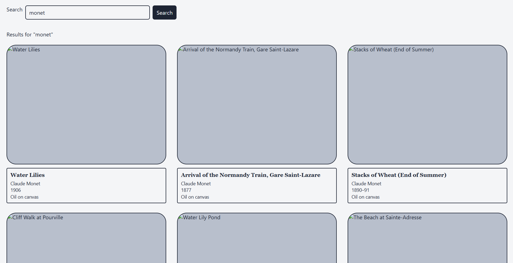

this is for who want to search a single or certain type of art work from chicago art institute, to run it, get in flask mode and type python -m flask --app app run --debug and open http://127.0.0.1:5000
